# Investigating DJI Mavic Air Flight Evidence

**SBT-DF204 Computer Forensics Case Studies**

## 1. Case Reference and Student Identification

| **Student full name**       | Basiru Aliyu                                                   |
|-----------------------------|----------------------------------------------------------------|
| **Registration number**     | FWSD2511424                                                    |
| **Course code**             | SBT-DF204 Computer Forensics Case Studies                      |
| **Case title**              | Investigating DJI Mavic Air Flight Evidence                    |
| **Date of examination**     | 2 November 2026 (working-copy extraction timestamps, S07, S10) |
| **Examination environment** | Kali Linux workstation                                         |

## 2. Executive Conclusion

The Android logical extraction contains DJI GO 4 (dji.go.v4) artefacts that point to one flight session on **19 June 2018**: a main flight record (TXT), a cached video of 4 min 0 s (MP4), and two detailed DAT records (FLY057, FLY058). The TXT contains the text “Mavic Air” and two 14-character strings in the format of DJI serial numbers. The TXT and MP4 were last written two seconds apart (17:55:40 and 17:55:42 UTC), and their filenames begin five seconds apart, which together support that they describe the same session.

The Mavic Air microSD, examined as a mounted card and as an EWF image, is a FAT32 volume with serial number 0x20191b01 holding five videos (DJI_0001 to DJI_0005.MP4). The first video has the same size on both representations (785,356,701 bytes) and the same FAT timestamps. Its write time is **2 February 2018**, about 4.5 months before the 19 June session, so the card video does not depict that session. The six cached pictures carry name stamps from April 2018 and do not corroborate it either.

**Confidence:** moderate that the mobile TXT and MP4 describe a single session on 19 June 2018; low that the microSD media is linked to that session; the raw and EWF microSD sources are consistent with each other pending a hash comparison. The findings establish activity of an application and device. They do not identify who was at the controls.

## 3. Evidence Acquisition and Integrity

### 3.1 Source evidence register

| **Ref** | **Original file / source**                       | **Source location**                    | **Byte size**                       | **Hash recorded**                          | **Evidence** |
|---------|--------------------------------------------------|----------------------------------------|-------------------------------------|--------------------------------------------|--------------|
| SRC-1   | Android_Logical.zip (Android logical extraction) | ~/SBT-DF204-Case5/                     | 415,154,789 (S05)                   | MD5 4f7623911818e8dc1ddceee4e26875be (S03) | E01, E02     |
| SRC-2   | Raw Mavic internal microSD image                 | Mounted as /media/kali/2019-1B01 (S21) | \[bytes\] | SHA-256 \[hash\] | E13          |

*Table 1. Source evidence. The brief requires MD5*

### 3.2 Working copies

| **Ref** | **Working-copy location and method**                                                                            | **Extraction / mount**                                                     |
|---------|-----------------------------------------------------------------------------------------------------------------|----------------------------------------------------------------------------|
| SRC-1   | working/Android_Logical created with cp --preserve=timestamps Android_Logical.zip working/Android_Logical (S04) | unzip -q Android_Logical.zip produced the Android_Logical/ directory (S05) |

*Table 2. Working copies and access method.*

### 3.3 Tools and versions

| **Tool**                                 | **Use**                                                                           |
|------------------------------------------|-----------------------------------------------------------------------------------|
| exiftool                                 | Media and file metadata                                                           |
| ewfmount (libewf)                        | Expose the EWF image as a raw device file                                         |
| VLC media player                         | Controlled preview of a working copy                                              |
| mediainfo, tree, stat, xxd, md5sum, file | Metadata, directory listing, timestamps, hex view, hashing, format identification |
| Sleuth Kit (fls, istat)                  | File listing and directory-entry times from the FAT volume                        |

*Table 3. Tools used.*

### 3.4 Access controls and handling gaps

Case folders evidence, working, exported, reports and screenshots were created before analysis (S01, S02). Analysis was carried out on working copies and offline; no artefact was executed and no evidence was uploaded to a drone portal, parser or cloud service.

## 4. Method

### 4.1 Mobile artefacts

The extracted Android tree was searched for dji.go.v4 data under sdcard/DJI/. tree listed the folders for flight records, cached video and cached images (S06, S09, S13). stat recorded size and timestamps before any metadata tool was run (S07, S10). The tail of the TXT was inspected with xxd (S08), and the MP4 with mediainfo and exiftool (S11, S12).

### 4.2 Raw microSD and EWF

The mounted card was inspected with stat (S21). The EWF image was exposed with ewfmount, identified with file, listed recursively with fls -r and a directory entry read with istat (S17 to S19, S22). The first card video was previewed with VLC (S20).

## 5. Findings

### Q1. How were the case materials preserved?

The Android archive was hashed before use (MD5 4f7623911818e8dc1ddceee4e26875be, 415,154,789 bytes), copied with timestamps preserved to working/, and then extracted (E01, E02; S03 to S05). The EWF image was hashed with MD5 d1651cfacd5b1827e337ad0a826002ae (E10; S16). Tool versions are in.

### Q2. What DJI GO 4 artefacts are present?

| **Family** | **Path (under Android_Logical/sdcard/DJI/dji.go.v4/)** | **Size** | **Evidence** |
|---|---|---|---|
| Main flight record (TXT) | FlightRecord/DJIFlightRecord_2018-06-19_\[14-50-34\].txt | 555,776 bytes | E03, E04 |
| Detailed flight records (DAT) | FlightRecord/MCDatFlightRecords/18-06-19-02-47-38_FLY057.DAT FlightRecord/MCDatFlightRecords/18-06-19-02-59-05_FLY058.DAT | \[bytes\] | E03 |
| Cached video (MP4) | DJI_RECORD/2018_06_19_14_50_39.mp4 with .info, analytics/…39.map and analytics/…39.tlv | 57,791,765 bytes | E06, E07 |
| Cached pictures | CACHE_IMAGE/ (six thumb\_\*.jpg files) | \[bytes\] | E09 |

*Table 4. DJI GO 4 artefact inventory. tree reported 2 directories and 3 files under FlightRecord (S06) and 4 files under DJI_RECORD (S09).*

### Q3. What does the main flight record establish?

| **Item**                      | **Observation**                                                                                                                                                                                                                                                                                                                                            |
|-------------------------------|------------------------------------------------------------------------------------------------------------------------------------------------------------------------------------------------------------------------------------------------------------------------------------------------------------------------------------------------------------|
| Source file                   | DJIFlightRecord_2018-06-19\_\[14-50-34\].txt, 555,776 bytes, inode 3298073 (S07)                                                                                                                                                                                                                                                                           |
| Aircraft / device information | The hex view of the file tail (S08) contains the text “Mavic Air” (near offset 0x87a52) followed by two 14-character strings, 0K1DF313BD4PR1 (0x87a67) and 0K4AEBQA3400DT (0x87a97). Their format matches DJI serial numbers. Which one is the aircraft, remote controller or battery is not determined from this output.                                  |
| Start event                   | Filename time 14:50:34 (device-local, zone not stated). Motor-on and take-off events from the parser:                                                                                                                                                                                                                                                      |
| End event                     | Last write 2018-06-19 12:55:40 −05:00 = 17:55:40 UTC (S07). Landing event from the parser:                                                                                                                                                                                                                                                                 |
| Time-zone anomaly             | The filename time (14:50:34) and the last-write time (17:55:40 UTC) are 3 h 05 min 06 s apart. If the filename were UTC, this would exceed the rated flight time of a Mavic Air (roughly 21 minutes) several times over, so the filename is not UTC. A device offset of UTC−03:00 gives a span of 5 min 06 s, which is plausible (hypothesis H1, Section 6 |

*Table 5. Main flight record. Evidence: E03, E04, E05; S06 to S08.*

### Q4. What does the cached video establish?

| **Item**            | **Observation**                                                                                                                                                    |
|---------------------|--------------------------------------------------------------------------------------------------------------------------------------------------------------------|
| Path and name       | DJI_RECORD/2018_06_19_14_50_39.mp4 (S09)                                                                                                                           |
| Size                | 57,791,765 bytes (55.1 MiB) (S10, S11)                                                                                                                             |
| File times          | Modify 2018-06-19 12:55:42 −05:00 = 17:55:42 UTC; originally Access = Modify (S10)                                                                                 |
| Embedded metadata   | MPEG-4 (isom), duration 4 min 0 s, 1,919 kb/s, 29.236 fps, writing application Lavf56.15.102 (S11, S12)                                                            |
| Start and end       | Start per filename 14:50:39 (device-local), five seconds after the TXT filename. End = start + 4 min 0 s = 14:54:39 local, about one minute before the last write. |
| Relationship to TXT | Filenames are 5 s apart and last-write times 2 s apart. This supports the same session. The video covers 4 minutes.                                                |

*Table 6. Cached video. Metadata was captured with stat (S10) before mediainfo and exiftool were run (S11, S12). The writer string Lavf indicates the file was produced with FFmpeg libraries, which is consistent with an app-generated cache rather than a camera original (inference).*

### Q5. What does the detailed flight record (DAT) establish?

Two DAT records are present, FLY057 and FLY058. Their filenames give start times of 02:47:38 and 02:59:05, 11 min 27 s apart. **The DAT content was not parsed in the supplied output**, so power-on, motor-on, take-off, landing and power-off events cannot yet be stated.

A DAT record runs from power-on to power-off, so it should begin earlier and end later than the TXT and MP4. The filename times use 02:xx where the TXT and MP4 use 14:xx. If the DAT names are on a 12-hour clock (14:47:38 and 14:59:05), FLY057 starts 2 min 56 s before the TXT and FLY058 starts about 4 minutes after the video ends, suggesting a second power cycle. This is a hypothesis to be tested against the parsed DAT content.

### Q6. What do cached pictures establish?

| **File (CACHE_IMAGE/)**                  | **Trailing number read as Unix ms** | **UTC**             |
|------------------------------------------|-------------------------------------|---------------------|
| thumb_6d9f39f0ca9decc3_1523610988000.jpg | 1523610988000                       | 2018-04-13 09:16:28 |
| thumb_5be64acbef28816c_1523610990000.jpg | 1523610990000                       | 2018-04-13 09:16:30 |
| thumb_7f92b744bbc53b3a_1523610992000.jpg | 1523610992000                       | 2018-04-13 09:16:32 |
| thumb_33177fb665068406_1523611394000.jpg | 1523611394000                       | 2018-04-13 09:23:14 |
| thumb_dd609e61934788b3_1523611494000.jpg | 1523611494000                       | 2018-04-13 09:24:54 |
| thumb_ed8c1a297e1061b4_1524152656000.jpg | 1524152656000                       | 2018-04-19 15:44:16 |

*Table 7. Cached pictures (S14).*

Four thumbnails show a bench or table surface with cabling, one shows an indoor room and one an outdoor landscape. The name stamps fall 61 to 67 days **before** 19 June 2018, so these pictures do not corroborate the 19 June session. Cached thumbnails can be created when media is browsed rather than captured, and their content alone cannot establish where or when a flight took place or who operated it.

### Q7. What does the raw internal microSD image show?

| **Item**                        | **Observation**                                                                                                   |
|---------------------------------|-------------------------------------------------------------------------------------------------------------------|
| Mounted volume                  | /media/kali/2019-1B01, named from the FAT volume serial 2019-1B01 (S21)                                           |
| File examined                   | DCIM/100MEDIA/DJI_0001.MP4, 785,356,701 bytes, inode 265, 1,533,952 blocks (S21)                                  |
| Timestamps as displayed by stat | Modify 2018-02-02 12:31:20 −05:00; Change 12:31:21 −05:00; Access 2018-06-20 20:00:00 −04:00; Birth not available |

*Table 8. Raw microSD. Evidence: E13.*

### Q8. What does the EWF image show and how does it compare?

| **Item**           | **Observation**                                                                                                                                                                                                                                                                                                                                                                                                                                                                                                   |
|--------------------|-------------------------------------------------------------------------------------------------------------------------------------------------------------------------------------------------------------------------------------------------------------------------------------------------------------------------------------------------------------------------------------------------------------------------------------------------------------------------------------------------------------------|
| Format and access  | DF048.E01 exposed with ewfmount 20140807 at ext_sd/ewf1 (S17).                                                                                                                                                                                                                                                                                                                                                                                                                                                    |
| Volume             | file reports a DOS/MBR boot sector at the start of ewf1: FAT32, OEM-ID “android ”, 16,777,216 sectors (8 GiB at 512 bytes), 64 sectors per cluster, volume serial 0x20191b01, unlabeled (S22). There is no partition table; the file system starts at sector 0.                                                                                                                                                                                                                                                   |
| Contents (fls -r)  | DCIM/100MEDIA: DJI_0001 to DJI_0005.MP4, plus deleted .DJI_0005.MP4.trinf and .DJI_0005.MP4.avc1. MISC/THM/100: DJI_0001 to DJI_0005.THM. MISC/GIS: dji.gis. MISC/IDX: two deleted .VR_dji\_\* entries. Also LOST.DIR, System Volume Information and .fseventsd (S18).                                                                                                                                                                                                                                            |
| DJI_0001.MP4 entry | istat -i raw on entry 1357829: allocated, 785,356,701 bytes, Written and Created 2018-02-02 17:31:20, Accessed 2018-06-21 (S19)                                                                                                                                                                                                                                                                                                                                                                                   |
| Content review     | Previewed in VLC 3.0.12 (S20). One frame shows two people indoors, one standing with arms crossed and one holding a hand controller beside a multirotor aircraft. A second frame shows a seated person behind a glass partition. At least three individuals appear across the two frames. Faces are pixelated in the screenshots. The setting is the inside of an open-plan room; no place name or GPS data is visible, so the location cannot be determined from this output. The dji.gis file was not analysed. |

*Table 9. EWF image. Evidence: E10 to E12, E14.*

**Comparison with the raw microSD**

| **Attribute**     | **Raw (mounted card)**                                      | **EWF**           | **Result**                               |
|-------------------|-------------------------------------------------------------|-------------------|------------------------------------------|
| DJI_0001.MP4 size | 785,356,701                                                 | 785,356,701       | Match                                    |
| Volume serial     | 2019-1B01 (mount name)                                      | 0x20191b01        | Match                                    |
| Written time      | 12:31:20 −05:00 = 17:31:20 UTC if stored as UTC             | 17:31:20 (stored) | Match, after accounting for host display |
| Access date       | 2018-06-21 00:00:00 UTC (displayed 2018-06-20 20:00 −04:00) | 2018-06-21        | Match (FAT stores date only)             |

*Table 10. Raw and EWF comparison. The stored FAT value is identical; the 5-hour difference between the two displays is the host’s offset conversion.*

The sources are consistent with the EWF image being a copy of the same card. Equal size, serial and timestamps are strong indicators but do not prove binary equality; a matching hash of the file, and of the full volume, would.

### Q9. What conclusion can be defended?

See Sections 6 and 7. In short: the TXT and MP4 describe one session on 19 June 2018 (moderate confidence), the microSD media examined predates it (high confidence for DJI_0001.MP4), and no person is identified.

## 6. Timeline and Correlation

### 6.1 Evidence-anchored events

Only values that can be converted to UTC from the supplied output are shown in UTC. Filename times with an unknown zone are shown as device-local.

| **Time**                                                     | **Evidence** | **Source**           | **Observed fact**                  | **Interpretation and limit**                                                           |
|--------------------------------------------------------------|--------------|----------------------|------------------------------------|----------------------------------------------------------------------------------------|
| 2018-02-02 17:31:20 (stored FAT value)                       | E13, E14     | microSD DJI_0001.MP4 | Written and created                | Card video predates the June session by about 137 days. Zone not recorded on the card. |
| 2018-04-13 09:16:28 to 09:24:54 UTC; 2018-04-19 15:44:16 UTC | E09          | CACHE_IMAGE names    | Six thumbnail stamps               | Predate the session; epoch reading assumed.                                            |
| 2018-06-19 02:47:38 (name, zone/clock unknown)               | E03          | DAT FLY057           | Filename start                     | Content not parsed; possibly 14:47:38 on a 12-hour clock.                              |
| 2018-06-19 14:50:34 device-local                             | E03          | TXT                  | Filename time                      | Zone unknown; not UTC.                                                                 |
| 2018-06-19 14:50:39 device-local                             | E06          | MP4                  | Filename start, duration 4 min 0 s | Implied end 14:54:39 device-local.                                                     |
| 2018-06-19 17:55:40 UTC                                      | E04          | TXT                  | Last write                         | End-of-record bound; depends on zip timestamp handling.                                |
| 2018-06-19 17:55:42 UTC                                      | E07          | MP4                  | Last write                         | Two seconds after the TXT.                                                             |
| 2018-06-19 02:59:05 (name, zone/clock unknown)               | E03          | DAT FLY058           | Filename start                     | Content not parsed.                                                                    |
| 2018-06-21 (date only)                                       | E13, E14     | microSD              | FAT access date                    | Card accessed after the session; handler unknown.                                      |

*Table 11. Material events.*

### 6.2 Flight sequence in the template stages (hypothesis H1)

**H1:** the device clock is UTC−03:00, and the DAT filenames are on a 12-hour clock. This is inferred from the 3 h 05 min gap in Table 5 and has not been confirmed. Under H1:

| **Stage**                          | **UTC (H1)**                                                 | **Evidence** | **Source** | **Observed fact and limit**                                                                    |
|------------------------------------|--------------------------------------------------------------|--------------|------------|------------------------------------------------------------------------------------------------|
| Device state and power or motor on | 2018-06-19 17:47:38                                          | E03          | DAT FLY057 | Filename 14:47:38 under H1. Motor-on event from DAT parser: \[add\]. |
| Take off or video start            | 17:50:34 (TXT) / 17:50:39 (MP4)                              | E03, E06     | TXT, MP4   | Filename times. Take-off from parser:                                                          |
| Main flight record event           | 17:50:34 to 17:55:40                                         | E03, E04     | TXT        | Start by filename, end by last write; duration 5 min 06 s under H1.                            |
| Landing or video end               | 17:54:39 (video end)                                         | E06, E08     | MP4        | Start + 4 min 0 s; landing from TXT parser:                                                    |
| Power off and correlation          | FLY057 end \[FLY058 start 17:59:05 | E03          | DAT        | FLY058 would be a later power cycle. Not corroborated by the TXT or MP4.                       |

*Table 12. Candidate sequence. Confidence: low to moderate until the offset is confirmed from the UTC time inside the parsed TXT.*

### 6.3 Cross-source correlation

| **Pair**                   | **Corroborates**                           | **Conflicts or differs**                                              | **Explanation**                                               |
|----------------------------|--------------------------------------------|-----------------------------------------------------------------------|---------------------------------------------------------------|
| TXT and MP4                | Filenames 5 s apart; last writes 2 s apart | Video 4 min 0 s; TXT duration not yet known                           | Different start and end conditions; same session likely.      |
| TXT and DAT                | Same date (19 June 2018)                   | DAT names show 02:xx against 14:xx                                    | Clock convention differs; DAT scope is power-on to power-off. |
| Cached MP4 and card video  | —                                          | 55.1 MiB, FFmpeg-written, 4 min vs 749 MiB card file dated 2 Feb 2018 | Different files from different dates; no match.               |
| Cached pictures and others | —                                          | Stamps in April 2018                                                  | No corroboration of the 19 June session.                      |
| Raw and EWF                | Size, volume serial, FAT times             | Hash not yet compared                                                 | Consistent with the same card.                                |

*Table 13. Corroboration and conflict.*

### 6.4 Direct observations and inferences

| **Direct observation**                                        | **Inference**                                     | **Confidence** |
|---------------------------------------------------------------|---------------------------------------------------|----------------|
| TXT and MP4 filenames carry 2018-06-19; last writes 2 s apart | Both belong to one DJI GO 4 session               | Moderate       |
| TXT tail contains “Mavic Air” and two serial-format strings   | The record concerns a Mavic Air                   | Moderate       |
| Card DJI_0001.MP4 written 2018-02-02                          | That video is not from the 19 June session        | High           |
| Raw and EWF share size, serial, FAT times                     | Same card, pending hash                           | Moderate       |
| A person holds a controller in a card video frame             | None about operator identity for the June session | —              |

## 7. Conclusion and Limitations

### 7.1 Conclusion

The DJI GO 4 artefacts support one session on 19 June 2018 involving a Mavic Air, with a 4-minute cached video. The microSD evidence, consistent across the mounted card and the EWF image, shows five recordings of which the first dates from 2 February 2018 and is unrelated to that session. The overall confidence is moderate for the mobile session and low for any link to the card. The evidence concerns a device and an application, not a named person.

### 7.2 Limitations and alternative explanations

1.  **Operator identity.** Records show an application and aircraft were active. The video frame of a person holding a controller comes from the February card video, not the June session, and shows presence, not control.

2.  **Device and account ownership.** The DJI GO 4 data shows an app on an Android handset. It does not show who owns the handset, the aircraft or the DJI account.

3.  **Time and time zone.** The filename time and last-write time differ by 3 h 05 min, the DAT names use a different clock convention, FAT times carry no zone, and zip timestamp handling is unverified. UTC values are therefore bounded, not proven.

4.  **Route and location.** No GPS or route data was parsed. The video shows an interior and the thumbnails show unidentified scenes, so no location is established.

5.  **Cache artefact limits.** The cached video is a transcoded 55.1 MiB file and the thumbnails predate the session by two months; neither is a primary recording.

6.  **Altered access times.** The MP4 access time changed from 2018-06-19 12:55:42 −05:00 (S10) to 2026-11-02 04:33:17 −06:00 (S12) after metadata tools ran. The card’s access date of 21 June 2018, together with System Volume Information and .fseventsd folders, shows it was attached to other computers after use.

7.  **Partial media.** The card has deleted entries for DJI_0005.MP4 and two index files. Only DJI_0001.MP4 was examined in detail.

8.  **Hash scope.** Matching hashes would show identical files, not when, where or by whom a flight was conducted.

### 7.3 Handling note

Video frames containing people were treated as sensitive. Faces are pixelated in the screenshots and no individual has been identified.

## Appendix A. Evidence Log

| **ID** | **Tool and method**       | **Source record, path or image**                 | **Observed fact**                                         | **Screenshot** |
|--------|---------------------------|--------------------------------------------------|-----------------------------------------------------------|----------------|
| E01    | md5sum                    | Android_Logical.zip                              | MD5 4f76…875be; SHA-256                                   | S03            |
| E02    | cp, unzip, ls             | working/Android_Logical; Android_Logical/        | Copy with timestamps; extraction; zip 415,154,789 bytes   | S04, S05       |
| E03    | tree                      | …/dji.go.v4/FlightRecord                         | TXT and two DAT files (FLY057, FLY058)                    | S06            |
| E04    | stat                      | DJIFlightRecord_2018-06-19\_\[14-50-34\].txt     | 555,776 bytes; modify 12:55:40 −05:00 (17:55:40 UTC)      | S07            |
| E05    | xxd -s -200               | Same TXT, file tail                              | “Mavic Air”; 0K1DF313BD4PR1; 0K4AEBQA3400DT               | S08            |
| E06    | tree -L 2 --inodes        | …/dji.go.v4/DJI_RECORD                           | mp4, .info, analytics/.map and .tlv                       | S09            |
| E07    | stat                      | 2018_06_19_14_50_39.mp4                          | 57,791,765 bytes; modify 12:55:42 −05:00 (17:55:42 UTC)   | S10            |
| E08    | mediainfo, exiftool 12.76 | Same MP4                                         | 4 min 0 s; 1,919 kb/s; Lavf56.15.102; access time changed | S11, S12       |
| E09    | tree, file manager        | …/dji.go.v4/CACHE_IMAGE                          | Six thumb\_\*.jpg; stamps April 2018                      | S13, S14       |
| E10    | md5sum, ewfmount          | DF048.E01                                        | MD5 d165…26002ae; mounted at ext_sd/ewf1                  | S15 to S17     |
| E11    | file                      | ext_sd/ewf1                                      | FAT32, 16,777,216 sectors, serial 0x20191b01              | S22            |
| E12    | fls -r                    | ext_sd/ewf1                                      | Five MP4/THM sets, dji.gis, deleted entries               | S18            |
| E13    | stat                      | /media/kali/2019-1B01/DCIM/100MEDIA/DJI_0001.MP4 | 785,356,701 bytes; modify 2018-02-02 12:31:20 −05:00      | S21            |
| E14    | istat -i raw              | ext_sd/ewf1 entry 1357829                        | Written 2018-02-02 17:31:20; accessed 2018-06-21          | S19            |
| E15    | VLC 3.0.12                | DJI_0001.MP4 (EWF)                               | Two frames; at least three people; interior               | S20            |

## Appendix B. Labelled Screenshots

S01 to S14 are from the examination of the Android extraction. S15 to S22 must be captured from your own session before submission.

### B.1 Preservation and working set

**S01** – Case folders created

**S02** – Working directory and folder check

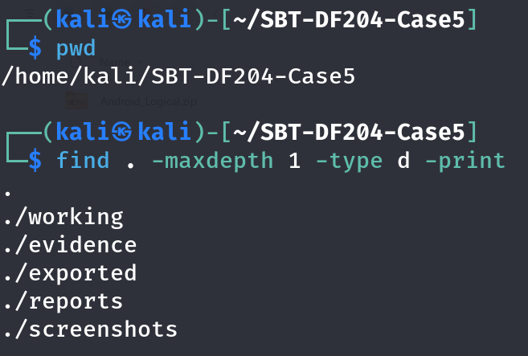

**S03** – MD5 of Android_Logical.zip

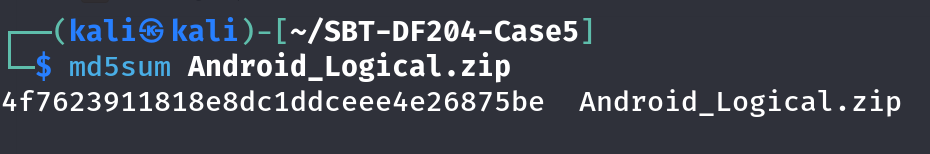

**S04** – Working copy made with timestamps preserved

**S05** – Extraction and directory listing with zip size

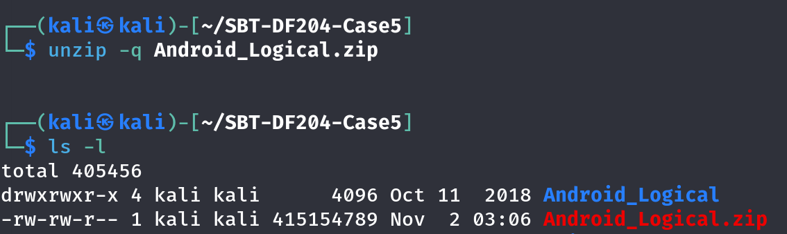

### B.2 DJI GO 4 artefacts

**S06** – FlightRecord folder: TXT and DAT files

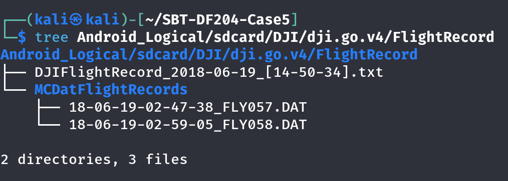

**S07** – TXT file size and timestamps

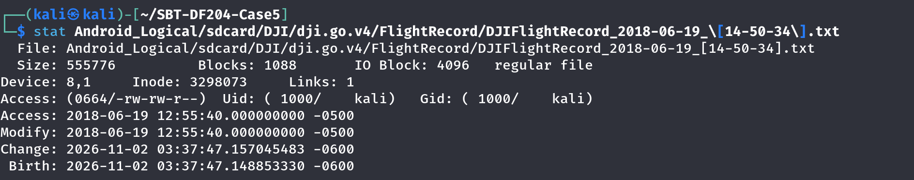

**S08** – TXT tail in hex: “Mavic Air” and serial-format strings

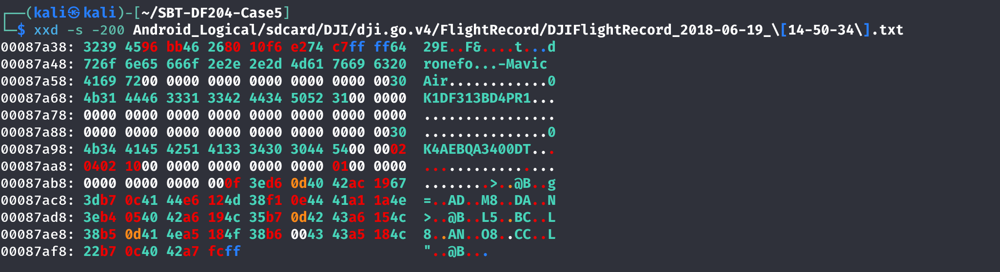

**S09** – DJI_RECORD folder: cached MP4 and companions

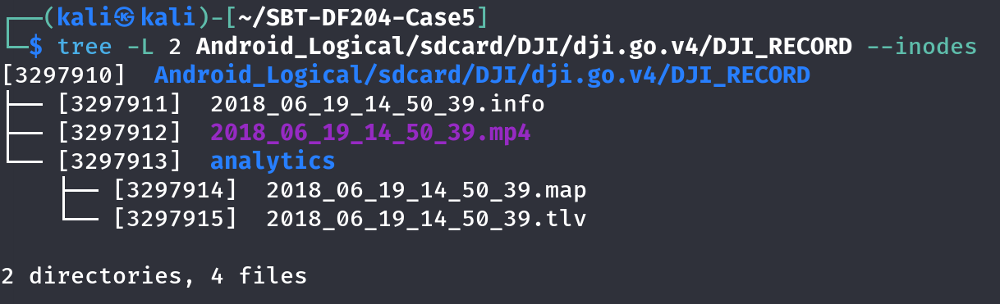

**S10** – MP4 size and timestamps before metadata tools

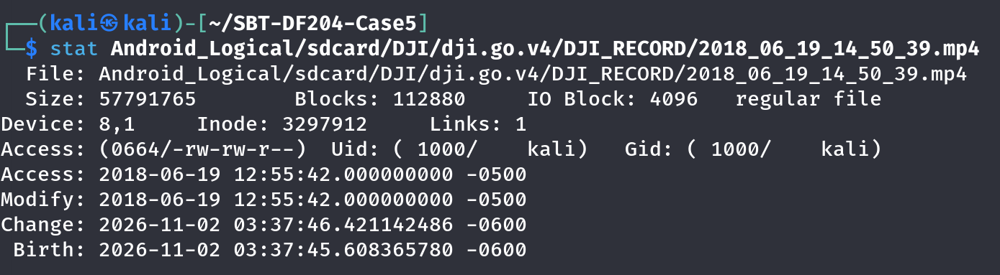

**S11** – mediainfo output for the cached MP4

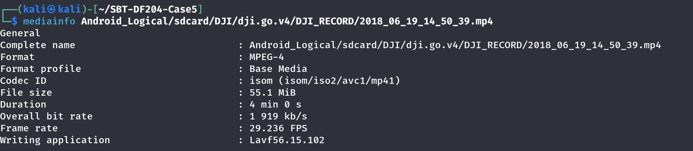

**S12** – exiftool output (access time now changed)

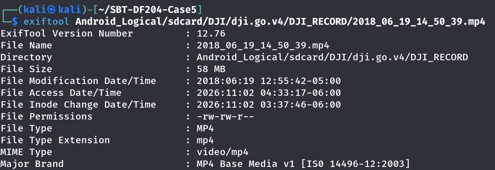

**S13** – dji.go.v4 folder listing showing CACHE_IMAGE

**S14** – CACHE_IMAGE thumbnails with file names

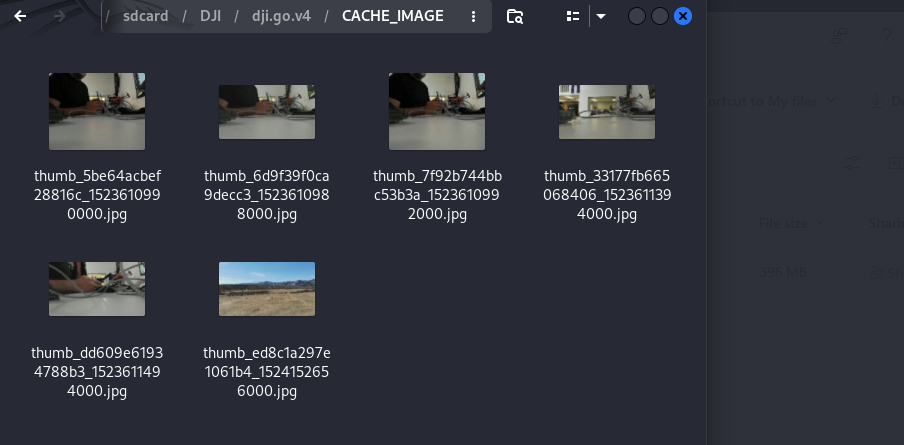
